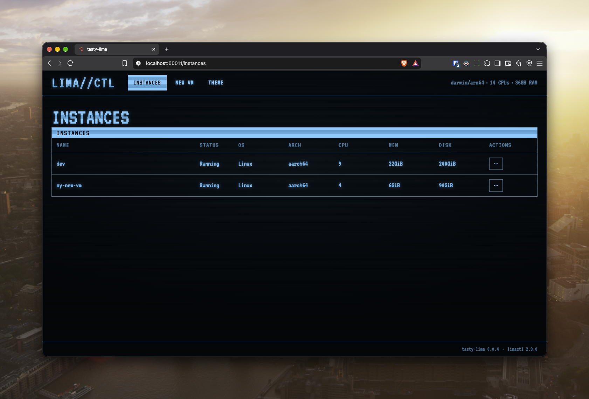

# tasty-lima

A quick and easy-to-use UI for creating and interacting with [Lima VMs](https://lima-vm.io).

`tasty-lima` ships as a single, self-contained CLI binary. Run it, and it boots a
local web UI for creating, starting, stopping, and editing Lima VMs, no Lima preinstallation is required!
On first run it automatically downloads the pinned `limactl` (and QEMU, if needed) into `~/.tasty-lima/`.

## Install

### Via npm

```sh
npm install -g tasty-lima
```

Then run:

```sh
tasty-lima
```

### Standalone binary

Download the build for your OS + arch from the
[GitHub releases page](https://github.com/benduran/tasty-lima/releases):

| File                          | Target                             |
| ----------------------------- | ---------------------------------- |
| `tasty-lima-macos-arm64`      | macOS (Apple Silicon)              |
| `tasty-lima-linux-x64`        | Linux (x86_64, glibc)              |
| `tasty-lima-linux-x64-musl`   | Linux (x86_64, musl — e.g. Alpine) |
| `tasty-lima-linux-arm64`      | Linux (ARM64, glibc)               |
| `tasty-lima-linux-arm64-musl` | Linux (ARM64, musl — e.g. Alpine)  |
| `tasty-lima-win-x64.exe`      | Windows (x86_64)                   |

On Unix machines (Linux and macOS), make the binary executable before running it:

```sh
chmod +x tasty-lima-macos-arm64
./tasty-lima-macos-arm64
```

> **macOS note:** Gatekeeper will likely block the first run since the binary
> isn't notarized. If macOS refuses to open it, go to **System Settings →
> Privacy & Security** and click **Allow Anyway** (or **Open Anyway**), then run
> it again.
>
> **Windows note:** Microsoft Defender SmartScreen may flag the `.exe` with an
> "Unknown publisher" warning. Click **More info → Run anyway** to proceed.

## Usage

```sh
tasty-lima [options]
```

| Option       | Default     | Description                                                 |
| ------------ | ----------- | ----------------------------------------------------------- |
| `-p, --port` | `60011`     | Port for the local helper server to listen on               |
| `--hostname` | `127.0.0.1` | Hostname for the local helper server                        |
| `--noUI`     | `false`     | Don't serve the web UI (utility for tasty-lima development) |

Once started, open the printed URL (e.g. `http://127.0.0.1:60011`) in your
browser.

## Screenshots

### Instances list



### Creating a VM


## Development

```sh
pnpm install        # install dependencies
pnpm dev            # UI dev server + CLI helper (tsx watch), via turbo
pnpm test           # biome lint + tsc typecheck
pnpm turbo build:all  # build the UI + all CLI binary targets into ./dist
```

### Bumping the lima version

`tasty-lima` only ever runs the `limactl` version pinned by `LIMA_VERSION` in [src/cli/constants.ts](src/cli/constants.ts), and its lima types are generated from that version's source.

1. Update `LIMA_VERSION`. `pnpm test:types` fails until the types are regenerated.
2. Run `pnpm gen:lima-types` (needs Go installed, ideally via [mise](https://mise.jdx.dev/). Go is defined in `.tool-versions`).
3. Review the diff of `src/cli/limactl/types.gen.ts` and fix any type errors. Never edit that file by hand.
