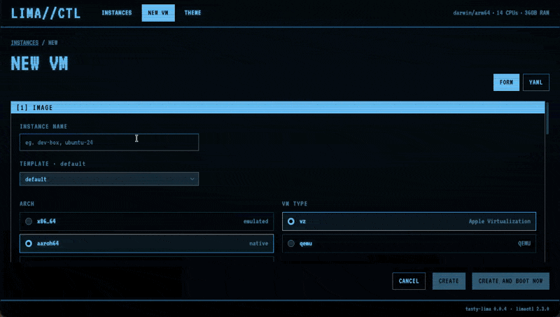

# tasty-lima

A quick and easy-to-use UI for creating and interacting with [Lima VMs](https://lima-vm.io).

`tasty-lima` ships as a single, self-contained CLI binary. Run it, and it boots a
local web UI for creating, starting, stopping, and editing Lima VMs, no Lima preinstallation is required!
On first run it automatically downloads the pinned `limactl` (and QEMU, if needed) into `~/.tasty-lima/`.

## Screenshots

### Instances list


### Creating a VM



## Install

### Via npm

```sh
npm install -g tasty-lima
```

Then run:

```sh
tasty-lima
```

### Standalone binary

Download the build for your OS + arch from the
[GitHub releases page](https://github.com/benduran/tasty-lima/releases):

| File                          | Target                             |
| ----------------------------- | ---------------------------------- |
| `tasty-lima-macos-arm64`      | macOS (Apple Silicon)              |
| `tasty-lima-linux-x64`        | Linux (x86_64, glibc)              |
| `tasty-lima-linux-x64-musl`   | Linux (x86_64, musl — e.g. Alpine) |
| `tasty-lima-linux-arm64`      | Linux (ARM64, glibc)               |
| `tasty-lima-linux-arm64-musl` | Linux (ARM64, musl — e.g. Alpine)  |
| `tasty-lima-win-x64.exe`      | Windows (x86_64)                   |

On Unix machines (Linux and macOS), make the binary executable before running it:

```sh
chmod +x tasty-lima-macos-arm64
./tasty-lima-macos-arm64
```

> **macOS note:** The binary is fully code signed, so you should have no problems downloading and running it without extra security prompts.
>
> **Windows note:** Microsoft Defender SmartScreen may flag the `.exe` with an
> "Unknown publisher" warning. Click **More info → Run anyway** to proceed.

## Usage

```sh
tasty-lima [options]
```

| Option          | Default     | Description                                                               |
| --------------- | ----------- | ------------------------------------------------------------------------- |
| `-p, --port`    | `60011`     | Port for the local helper server to listen on                             |
| `--hostname`    | `127.0.0.1` | Hostname for the local helper server                                      |
| `--noOpen`      | `false`     | Don't open the system's default web browser on start                      |
| `--noUI`        | `false`     | Don't serve the web UI (utility for tasty-lima development)               |
| `--allowOrigin` | none        | Extra browser origin allowed to call the API (for tasty-lima development) |

`tasty-lima` will automatically open your browser and print the link you should use to access the `tasty-lima` UI (e.g. `http://127.0.0.1:60011/#t=<token>`).
The link will have an access token embedded, which changes on every launch.
Treat the link like a password.
A link without the correct token embedded will not work.

## Secure by default

`tasty-lima` treats the code inside a VM as untrusted (things like `npm` postinstall scripts,
Rust `build.rs`, anything dodgy you'd rather not run on your own machine).
Nothing in a VM should be able to escape the VM and access your personal computer's files, applications, your credentials or `tasty-lima` itself, unless you explicitly allow it.

A new VM starts locked down, adhering to the following guidelines:

### No SSH agent forwarding

Forwarding exposes your host SSH keys to everything running in the VM while you're connected.
It's recommended to create unique SSH keys that are only used inside of the VM, so you can revoke them if your VM is compromised, leaving your host machine untouched / unaffected.

If a VM needs git access, give it its own key instead of forwarding your agent.
Run this inside the VM, then add the public key to your git host as a deploy key:

```bash
ssh-keygen -t ed25519 -f ~/.ssh/id_ed25519 -N "" -C "lima-$(hostname)"
```

### No host folders

By default, the VM only sees the folders you add yourself, and starts with zero folders shared / mounted between the host and the VM.
Creating or editing a VM will fail if `~/.lima/_config/default.yaml` or `override.yaml` tries to sneak in a mount, or make one writable, that you didn't ask for.

### No access to apps on your computer (Apple Virtualization only)

New `vz` VMs set `networkOpts.hostLoopback: false`, so the VM cannot connect to anything listening on your machine's `127.0.0.1`.
Turn on "Let this VM connect to apps running on your computer" if it needs a local database, dev server or proxy.
Lima cannot switch this off for QEMU, WSL2 or `user-v2` networks.

### A locked local API

Every API and WebSocket request needs the access token from the startup link, which is what keeps outside actors, including code running inside of your VMs, from controlling `tasty-lima`.
Requests from other websites (an unexpected `Origin` or `Host`) are rejected, too.

Keep `--hostname` on a loopback address, like `localhost` or `127.0.0.1`.
On any other address `tasty-lima` prints a warning and stops checking the `Host` header, so the token does most of the work, and it then crosses your network unencrypted.

## Development

```sh
pnpm install        # install dependencies
pnpm dev            # UI dev server + CLI helper (tsx watch), via turbo
pnpm test           # biome lint + tsc typecheck
pnpm turbo build:all  # build the UI + all CLI binary targets into ./dist
```

### Bumping the lima version

`tasty-lima` only ever runs the `limactl` version pinned by `LIMA_VERSION` in [src/cli/constants.ts](src/cli/constants.ts), and its lima types are generated from that version's source.

1. Update `LIMA_VERSION`. `pnpm test:types` fails until the types are regenerated.
2. Run `pnpm gen:lima-types` (needs Go installed, ideally via [mise](https://mise.jdx.dev/). Go is defined in `.tool-versions`).
3. Review the diff of `src/cli/limactl/types.gen.ts` and fix any type errors. Never edit that file by hand.
